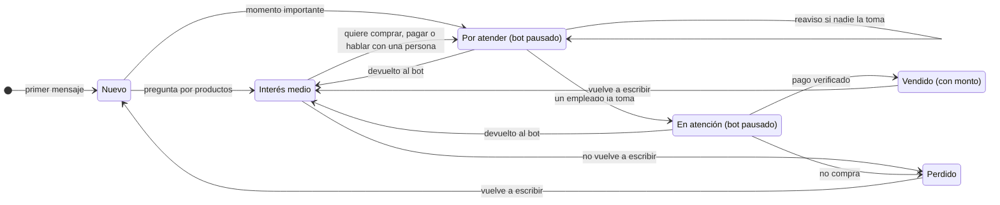
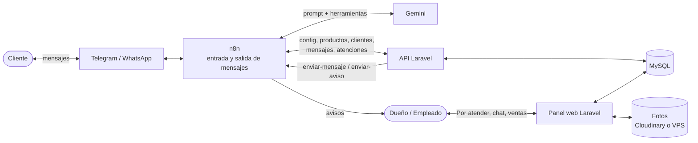

# SaaS de ventas por WhatsApp con n8n

Plataforma para que las tiendas tengan un **agente de inteligencia artificial que atiende a sus clientes por chat** (WhatsApp, y Telegram en el MVP): resuelve las dudas básicas, motiva la compra y, **cuando el cliente quiere comprar o pagar, se pausa y lo pasa a una persona**, que concreta la venta y verifica el pago desde un panel web.

> **Estado:** en planeación y primeras pruebas. El agente ya responde en un chat de prueba de n8n; el panel web todavía no está construido.

---

## Tabla de contenido

- [El problema](#el-problema)
- [Cómo funciona](#cómo-funciona)
- [Funcionalidades](#funcionalidades)
- [Arquitectura](#arquitectura)
- [Tecnologías](#tecnologías)
- [Base de datos](#base-de-datos)
- [Roles y permisos](#roles-y-permisos)
- [Hoja de ruta](#hoja-de-ruta)
- [Documentación del repositorio](#documentación-del-repositorio)
- [Cómo probar el agente en local](#cómo-probar-el-agente-en-local)
- [Costos de referencia](#costos-de-referencia)

---

## El problema

Los negocios pequeños reciben muchos mensajes por WhatsApp de personas que solo preguntan precios o curiosean. Responder a todos quita tiempo, y mientras tanto los clientes que sí quieren comprar esperan o se pierden, sobre todo fuera del horario de atención.

## Cómo funciona

1. Un cliente le escribe al negocio por chat.
2. El agente de IA responde como lo haría un vendedor de la tienda: corto, cercano y con la información real del catálogo (precios, colores, envíos, medios de pago y promociones).
3. Cuando llega un **momento importante** (quiere comprar o pagar, envía un comprobante, pide descuento, tiene un reclamo o pide hablar con una persona), el agente:
   - deja anotados el motivo, un resumen y lo que el cliente quiere (producto, talla o color, cantidad, ciudad),
   - envía **un último mensaje** (por ejemplo: "Listo, Andrés te confirma todo por aquí"), distinto si el negocio está abierto o cerrado,
   - y **se pausa** para ese cliente.
4. El cliente aparece en la lista **"Por atender"** del panel y el encargado recibe un aviso por Telegram.
5. El dueño o un empleado **toma la atención**, **responde desde el panel** (el mensaje sale por el mismo chat), **verifica el pago** y la marca como **vendida con su monto** o como perdida. Si no hacía falta una persona, puede **devolver el cliente al bot**.
6. Si nadie toma la atención en cierto tiempo, el sistema **vuelve a avisar**.

> El bot **nunca** da datos para pagar ni confirma pagos. Eso siempre lo hace una persona.



## Funcionalidades

**Para el cliente final**
- Atención por chat a cualquier hora.
- Respuestas con información real del catálogo y fotos de los productos.
- Paso a una persona cuando quiere comprar, pagar o lo pide.

**Para el dueño y sus empleados**
- Lista **"Por atender"** con el motivo, el resumen y lo que quiere cada cliente.
- Avisos por Telegram cuando hay alguien por atender o cuando un cliente pausado vuelve a escribir.
- Chat en el panel para responderle al cliente por el mismo canal.
- Cierre de cada atención como vendida (con monto) o perdida, y opción de devolver el cliente al bot.
- Tablero de clientes por estado e historial de conversaciones.
- Gestión del catálogo (productos, categorías, precios, variantes, stock y fotos), de los datos del negocio y de los empleados.

**Para la administración de la plataforma**
- Alta y activación de negocios, con la configuración de su canal.
- Configuración del agente de cada negocio (nombre, tono, reglas).
- Plantillas de instrucciones por tipo de negocio.
- Suscripciones de los negocios y control de consumo.

## Arquitectura

Es un **SaaS multi-negocio**: una sola plataforma y **un solo flujo de n8n** atienden a todos los negocios. Cada mensaje se procesa de forma independiente y en paralelo.

- **Laravel decide y guarda:** API del agente, panel web, reglas de negocio y tareas programadas.
- **n8n es la única puerta de mensajes:** recibe lo que escribe el cliente, habla con la IA y envía todo lo que sale (respuestas del bot, mensajes de los empleados y avisos). Así, pasar de Telegram a WhatsApp solo toca n8n.



**Flujo de un mensaje en n8n**

1. Llega el mensaje del cliente.
2. Se consulta la configuración del negocio (con su horario) y el cliente, y se guarda el mensaje.
3. Si el bot está pausado para ese cliente, no responde: el encargado ya recibió el aviso.
4. Si no, el agente responde. Tiene dos herramientas: **buscar_productos** y **pasar_a_persona**.
5. Si usa `pasar_a_persona`, se crea la atención, se pausa el bot, se avisa al encargado y su respuesta es el último mensaje.

## Tecnologías

| Parte | Tecnología |
| --- | --- |
| Panel web y API | Laravel (PHP 8.3) |
| Base de datos | MySQL |
| Automatización y agente | n8n (self-hosted) |
| Modelo de IA | Google Gemini por API (intercambiable por Claude u OpenAI) |
| Memoria del agente | Simple Memory en pruebas; Postgres o Redis en producción |
| Caché y colas | Redis |
| Fotos | Cloudinary para demos; disco del VPS en producción |
| Mensajería | Telegram para pruebas; WhatsApp Business API en producción |
| Servidor | VPS con Docker Compose (Hostinger KVM 2 recomendado) |

## Base de datos

Todas las tablas de datos llevan `negocio_id`, así cada negocio solo ve su información.

| Tabla | Para qué sirve |
| --- | --- |
| `plantillas` | Instrucciones base del agente por tipo de negocio |
| `negocios` | Ficha de cada negocio, su canal, su horario y la configuración de su agente |
| `usuarios` | Acceso al panel (dueño, empleado, admin) |
| `categorias` | Organización del catálogo |
| `productos` | Catálogo con precio, variantes y stock |
| `producto_fotos` | Fotos de cada producto (`disco`, `ruta`, `url`) |
| `clientes` | Personas que escriben, su estado y si el bot está pausado |
| `atenciones` | Cada vez que el bot pasa un cliente a una persona: motivo, resumen, quién atiende y monto vendido |
| `mensajes` | Historial de cada conversación (cliente, bot o persona) |
| `suscripciones` | Plan que cada negocio paga por usar la plataforma |

El diagrama completo está en [`diagramas-saas.drawio`](diagramas-saas.drawio).

## Roles y permisos

| Rol | Qué puede hacer |
| --- | --- |
| **Administradora** | Crear negocios, configurar el agente de cada uno, gestionar plantillas, suscripciones y consumo. |
| **Dueño** | Gestionar su catálogo, los datos de su negocio y sus empleados; atender clientes, verificar pagos y registrar ventas. No puede cambiar la configuración del agente. |
| **Empleado** | Atender la lista "Por atender": responder desde el panel, verificar pagos y registrar ventas. |

## Hoja de ruta

El trabajo está organizado en [issues](../../issues) y en 6 [hitos](../../milestones). El **MVP** es el sistema funcionando de punta a punta con Telegram y fotos en Cloudinary: etapas 1 a 3, más #21 y #23.

| Etapa | Contenido | Issues |
| --- | --- | --- |
| 1. Base del sistema y catálogo | Proyecto Laravel, base de datos, login por roles, negocios, empleados, productos y fotos | #1 – #8, #32 |
| 2. Configuración del agente y n8n | Configuración del agente, plantillas, API y flujo de n8n con herramientas | #9 – #13 |
| 3. Paso a una persona y atención | Pausa automática, avisos, "Por atender", tomar, responder desde el panel, vender con monto, devolver al bot, reavisos | #14 – #20, #33 – #36 |
| 4. Canales de mensajería | Telegram, WhatsApp Business API, fotos en el chat, memoria persistente | #21 – #24 |
| 5. Despliegue | VPS con Docker, copias de seguridad, migración de fotos | #25 – #27 |
| 6. Suscripciones y escalado | Suscripciones, consumo por negocio, n8n en modo cola | #28 – #30 |

## Documentación del repositorio

| Archivo | Contenido |
| --- | --- |
| [`diagramas-saas.drawio`](diagramas-saas.drawio) | Base de datos, actores, casos de uso, flujo de un mensaje, estados del cliente y arquitectura. Se abre en [app.diagrams.net](https://app.diagrams.net). Se genera con [`docs/herramientas/generar_diagramas.py`](docs/herramientas/generar_diagramas.py). |
| [`docs/contexto-proyecto.md`](docs/contexto-proyecto.md) | Decisiones del proyecto, API, flujo de n8n, estado actual, costos y competencia. |
| [`docs/prompt-cumbre-caps.md`](docs/prompt-cumbre-caps.md) | Instrucciones del agente de prueba (tienda de gorras ficticia en Cali). |
| [`CLAUDE.md`](CLAUDE.md) | Contexto para trabajar el proyecto con Claude Code. |

## Cómo probar el agente en local

Requisitos: Node.js 20 o 22 y una clave de API de Gemini (gratis en [aistudio.google.com](https://aistudio.google.com)).

1. Levanta n8n:
   ```bash
   npx n8n
   ```
2. Entra a `http://localhost:5678` y crea tu cuenta local.
3. Crea un flujo con estos nodos:
   - **Chat Trigger** ("When chat message received").
   - **AI Agent**, con **Google Gemini Chat Model** (un modelo Flash o Flash Lite) y **Simple Memory** (ventana de 10 mensajes).
4. En el AI Agent, en *Options → System Message*, pega el prompt de [`docs/prompt-cumbre-caps.md`](docs/prompt-cumbre-caps.md). Cambia `{{abierto_ahora}}` por un texto como "Abierto. Cierra hoy a las 8:00 p.m.". Sin la herramienta `pasar_a_persona`, el agente envía su último mensaje pero no se pausa; la herramienta llega en la Etapa 2.
5. Abre el chat del flujo y escríbele como si fueras un cliente.

> Evita los modelos que dicen *TTS* (responden con audio) y, si un modelo *Preview* da error de saturación, cambia a otro.

## Costos de referencia

Valores aproximados consultados en noviembre de 2026; verifícalos antes de decidir.

- **VPS Hostinger KVM 2:** desde ~US$8.79 al mes con promoción (2 núcleos, 8 GB de RAM, 100 GB).
- **n8n self-hosted:** gratis y sin límite de ejecuciones (el modelo de IA se paga aparte).
- **Cloudinary:** plan gratis de 25 créditos compartidos entre almacenamiento, descargas y transformaciones.
- **WhatsApp Business API:** Meta cobra por mensajes de plantilla según el país.
