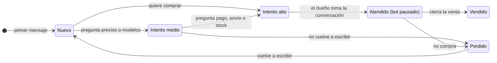
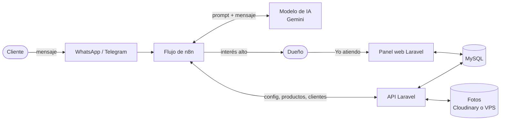

# SaaS de ventas por WhatsApp con n8n

Plataforma para que cualquier negocio (tiendas de ropa, calzado, tecnología, comida y más) tenga un **agente de inteligencia artificial que atiende a sus clientes por WhatsApp**, resuelve las dudas básicas, motiva la compra y **avisa al dueño cuando un cliente está listo para comprar**, para que él cierre la venta personalmente.

> **Estado:** en planeación y primeras pruebas. El agente ya responde en un chat de prueba de n8n; el panel web todavía no está construido.

---

## Tabla de contenido

- [El problema](#el-problema)
- [Cómo funciona](#cómo-funciona)
- [Funcionalidades](#funcionalidades)
- [Arquitectura](#arquitectura)
- [Tecnologías](#tecnologías)
- [Base de datos](#base-de-datos)
- [Roles y permisos](#roles-y-permisos)
- [Hoja de ruta](#hoja-de-ruta)
- [Documentación del repositorio](#documentación-del-repositorio)
- [Cómo probar el agente en local](#cómo-probar-el-agente-en-local)
- [Costos de referencia](#costos-de-referencia)

---

## El problema

Los negocios pequeños reciben muchos mensajes por WhatsApp de personas que solo preguntan precios o curiosean. Responder a todos quita tiempo, y mientras tanto los clientes que sí quieren comprar esperan o se pierden, sobre todo fuera del horario de atención.

## Cómo funciona

1. Un cliente le escribe al negocio por WhatsApp.
2. El agente de IA responde como lo haría un vendedor de la tienda: corto, cercano y con la información real del catálogo (precios, colores, envíos, pagos y promociones).
3. Mientras conversa, el agente **clasifica el interés** del cliente:
   - **Bajo:** saluda o curiosea.
   - **Medio:** pregunta por modelos o precios concretos.
   - **Alto:** pregunta cómo pagar, por disponibilidad o por envíos, o dice que quiere comprar.
4. Si el interés es alto, el sistema **le avisa al dueño** con el nombre del cliente, su número y un resumen de la conversación.
5. El dueño pulsa **"Yo atiendo"** en su panel, el bot deja de responder a ese cliente y el dueño cierra la venta él mismo.



## Funcionalidades

**Para el cliente final**
- Atención por WhatsApp a cualquier hora.
- Respuestas con información real del catálogo y fotos de los productos.

**Para el dueño del negocio**
- Panel web para gestionar el catálogo: productos, categorías, precios, variantes, stock y fotos.
- Edición de los datos del negocio: horario, dirección, envíos, pagos y promociones.
- Aviso inmediato cuando un cliente tiene interés alto.
- Tablero de clientes por estado e historial de conversaciones.
- Botón "Yo atiendo" para pausar el bot y atender personalmente.
- Registro de ventas cerradas y perdidas.

**Para la administración de la plataforma**
- Alta y activación de negocios.
- Configuración del agente de cada negocio (nombre, tono, reglas).
- Plantillas de instrucciones por tipo de negocio.
- Suscripciones de los negocios y control de consumo.

## Arquitectura

Es un **SaaS multi-negocio**: una sola plataforma y **un solo flujo de n8n** atienden a todos los negocios. Cada mensaje se procesa de forma independiente y en paralelo. El flujo identifica a qué negocio le escribieron por el número de WhatsApp y carga su configuración y su catálogo desde la API.



**Flujo de un mensaje en n8n**

1. Llega el mensaje (WhatsApp, o Telegram en pruebas).
2. Se consulta la configuración del negocio y su prompt.
3. Se revisa si el bot está pausado para ese cliente. Si lo está, no responde.
4. El agente de IA responde usando la memoria de la conversación y busca productos en el catálogo cuando lo necesita.
5. Si detecta interés alto, registra el cliente interesado y avisa al dueño.
6. Se envía la respuesta (y la foto, si aplica) y se guarda la conversación.

## Tecnologías

| Parte | Tecnología |
| --- | --- |
| Panel web y API | Laravel (PHP 8.3) |
| Base de datos | MySQL |
| Automatización y agente | n8n (self-hosted) |
| Modelo de IA | Google Gemini por API (intercambiable por Claude u OpenAI) |
| Memoria del agente | Simple Memory en pruebas; Postgres o Redis en producción |
| Caché y colas | Redis |
| Fotos | Cloudinary para demos; disco del VPS en producción |
| Mensajería | Telegram para pruebas; WhatsApp Business API en producción |
| Servidor | VPS con Docker Compose (Hostinger KVM 2 recomendado) |

## Base de datos

Todas las tablas de datos llevan `negocio_id`, así cada negocio solo ve su información.

| Tabla | Para qué sirve |
| --- | --- |
| `plantillas` | Instrucciones base del agente por tipo de negocio |
| `negocios` | Ficha de cada negocio y la configuración de su agente |
| `usuarios` | Acceso al panel (dueño, empleado, admin) |
| `categorias` | Organización del catálogo |
| `productos` | Catálogo con precio, variantes y stock |
| `producto_fotos` | Fotos de cada producto (`disco`, `ruta`, `url`) |
| `clientes` | Personas que escriben, su nivel de interés y si el bot está pausado |
| `mensajes` | Historial de cada conversación |
| `suscripciones` | Plan que cada negocio paga por usar la plataforma |

El diagrama completo está en [`diagramas-saas.drawio`](diagramas-saas.drawio).

## Roles y permisos

| Rol | Qué puede hacer |
| --- | --- |
| **Administradora** | Crear negocios, configurar el agente de cada uno, gestionar plantillas, suscripciones y consumo. |
| **Dueño** | Gestionar su catálogo y los datos de su negocio, atender clientes interesados y ver el historial. No puede cambiar la configuración del agente. |
| **Empleado** | Atender clientes del negocio al que pertenece. |

## Hoja de ruta

El trabajo está organizado en [issues](../../issues) y en 6 [hitos](../../milestones):

| Etapa | Contenido | Issues |
| --- | --- | --- |
| 1. Base del sistema y catálogo | Proyecto Laravel, base de datos, login por roles, negocios, productos y fotos | #1 – #8 |
| 2. Configuración del agente y n8n | Configuración del agente, plantillas, API y flujo de n8n conectado | #9 – #13 |
| 3. Clientes y aviso al dueño | Interés alto, aviso por Telegram, tablero, "Yo atiendo", historial | #14 – #20 |
| 4. Canales de mensajería | Telegram, WhatsApp Business API, fotos en el chat, memoria persistente | #21 – #24 |
| 5. Despliegue | VPS con Docker, copias de seguridad, migración de fotos | #25 – #27 |
| 6. Suscripciones y escalado | Suscripciones, consumo por negocio, n8n en modo cola | #28 – #30 |

## Documentación del repositorio

| Archivo | Contenido |
| --- | --- |
| [`diagramas-saas.drawio`](diagramas-saas.drawio) | Base de datos, actores, casos de uso, flujo de un mensaje y estados del cliente. Se abre en [app.diagrams.net](https://app.diagrams.net). |
| [`docs/contexto-proyecto.md`](docs/contexto-proyecto.md) | Decisiones del proyecto, API, flujo de n8n, estado actual, costos y competencia. |
| [`docs/prompt-cumbre-caps.md`](docs/prompt-cumbre-caps.md) | Instrucciones del agente de prueba (tienda de gorras ficticia en Cali). |
| [`CLAUDE.md`](CLAUDE.md) | Contexto para trabajar el proyecto con Claude Code. |

## Cómo probar el agente en local

Requisitos: Node.js 20 o 22 y una clave de API de Gemini (gratis en [aistudio.google.com](https://aistudio.google.com)).

1. Levanta n8n:
   ```bash
   npx n8n
   ```
2. Entra a `http://localhost:5678` y crea tu cuenta local.
3. Crea un flujo con estos nodos:
   - **Chat Trigger** ("When chat message received").
   - **AI Agent**, con **Google Gemini Chat Model** (un modelo Flash o Flash Lite) y **Simple Memory** (ventana de 10 mensajes).
4. En el AI Agent, en *Options → System Message*, pega el prompt de [`docs/prompt-cumbre-caps.md`](docs/prompt-cumbre-caps.md).
5. Abre el chat del flujo y escríbele como si fueras un cliente.

> Evita los modelos que dicen *TTS* (responden con audio) y, si un modelo *Preview* da error de saturación, cambia a otro.

## Costos de referencia

Valores aproximados consultados en noviembre de 2026; verifícalos antes de decidir.

- **VPS Hostinger KVM 2:** desde ~US$8.79 al mes con promoción (2 núcleos, 8 GB de RAM, 100 GB).
- **n8n self-hosted:** gratis y sin límite de ejecuciones (el modelo de IA se paga aparte).
- **Cloudinary:** plan gratis de 25 créditos compartidos entre almacenamiento, descargas y transformaciones.
- **WhatsApp Business API:** Meta cobra por mensajes de plantilla según el país.
